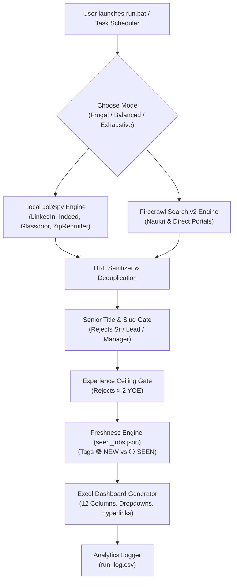

# 🎯 Automated Multi-Platform Job Hunter & Application Tracker

An enterprise-grade, privacy-first job aggregation and tracking engine. It automatically discovers, validates, and filters job postings across **5 major platforms** (**LinkedIn, Indeed, Glassdoor, ZipRecruiter, and Naukri**), enriches listings with extracted skills, eliminates senior roles for 0–2 YOE freshers, tracks lead freshness, and builds a styled, interactive **Excel Application Dashboard** with native **"Apply Now"** buttons and status dropdowns.

---

## 📑 Table of Contents
- [How It Works](#-how-it-works)
- [How to Share This Tool with Friends](#-how-to-share-this-tool-with-friends)
- [Quick Start Guide (For You or a Friend)](#-quick-start-guide-for-you-or-a-friend)
- [Customizing Your Search (`config.yaml`)](#-customizing-your-search-configyaml)
- [Scraping Modes & Credit Budgeting](#-scraping-modes--credit-budgeting)
- [Understanding the Excel Tracker](#-understanding-the-excel-tracker)
- [Automating Daily Sweeps (Windows Task Scheduler)](#-automating-daily-sweeps-windows-task-scheduler)
- [Architecture & File Reference](#-architecture--file-reference)
- [Troubleshooting](#-troubleshooting)

---

## 🧠 How It Works



1. **Dual Scraping Engines**:
   - **JobSpy (Free, Local)**: Queries LinkedIn, Indeed, Glassdoor, and ZipRecruiter directly.
   - **Firecrawl Search v2 (Cloud)**: Targets direct Naukri listing paths and corporate career boards with optional full markdown parsing.
2. **Strict Quality Gating**:
   - Extracts real experience requirements from Naukri URL slugs (`-1-to-2-years-`) and description bodies.
   - Detects and drops senior listings (`Senior`, `Sr.`, `Lead`, `Manager`, `Architect`, `Principal`, `Director`).
   - Discards any job requiring $> 2$ years minimum experience.
3. **Freshness Tracking**:
   - Remembers previously seen jobs in `seen_jobs.json`.
   - New listings are highlighted as **`🟢 NEW`** (Bold Green).
   - Repeated listings from earlier runs are tagged as **`⚪ SEEN`** (Slate Gray).
   - Automatically prunes entries older than 14 days to keep memory clean.
4. **Interactive Excel Output**:
   - Clickable native **"Apply Now"** buttons jump straight to the application page.
   - Application Status dropdowns (`Not Applied`, `Applied`, `Interviewing`, `Offer Received`, etc.).
   - Protected against file locks: if open in Excel, saves to `_Latest.xlsx` without crashing.

---

## 🤝 How to Share This Tool with Friends

When sharing this project folder with a friend, follow these privacy rules:

### ✅ Files to Send:
- `config.yaml` (their configuration)
- `requirements.txt` (dependencies)
- `.env.example` (API key template)
- `extractor.py` (skills extraction logic)
- `scraper.py` (scraping engine)
- `excel_generator.py` (Excel builder)
- `main.py` (CLI orchestrator)
- `run.bat` (1-click interactive runner)
- `run_scheduled.bat` (headless scheduler runner)
- `README.md` (this guide)
- `.gitignore` (prevents accidental credential leaks)

### ⛔ NEVER Send These Files:
- **`.env`** (⚠️ Contains your private API key! Never share this file).
- `seen_jobs.json` (Contains your personal run history; let them generate their own fresh file).
- `run_log.csv` (Your credit usage and run analytics).
- `Job_Applications_Tracker.xlsx` (Your personal job leads).
- `__pycache__/` (Machine-specific compiled cache).

---

## ⚡ Quick Start Guide (For You or a Friend)

### Step 1: Install Python
Ensure Python 3.10+ (tested and verified up to Python 3.13) is installed.
- Download from [python.org](https://www.python.org/downloads/).
- **Important**: Check the box that says **"Add python.exe to PATH"** during installation.

### Step 2: Set Up API Keys (Optional but Recommended)
1. In the project folder, make a copy of `.env.example` and rename it to `.env`.
2. Get a free API key with 1,000 free credits from [Firecrawl.dev](https://www.firecrawl.dev).
3. Paste the key inside `.env`:
   ```env
   FIRECRAWL_API_KEY=fc-YOUR_API_KEY_HERE
   ```
> **Note**: If you don't provide an API key, the tool will gracefully skip Firecrawl and still scrape LinkedIn, Indeed, Glassdoor, and ZipRecruiter for **100% free**!

### Step 3: Run the Tool!
- **Windows**: Just double-click **`run.bat`**.
  - It will automatically verify your Python environment, install any missing libraries from `requirements.txt`, display the mode selector, and begin scraping.
- **Mac / Linux / Terminal**:
  ```bash
  pip install -r requirements.txt
  python main.py --mode balanced
  ```

---

## ⚙️ Customizing Your Search (`config.yaml`)

Anyone can tailor the bot to their specific field, skills, or target city by opening [`config.yaml`](file:///d:/ANTIGRAVITY%20WORKSPACE/job_automation/config.yaml):

```yaml
search:
  # Target job designations
  job_titles:
    - "Data Analyst"
    - "Data Annotator"
    - "SQL Developer"
    - "Power BI Developer"

  # Target city or region (e.g. "Hyderabad", "Bengaluru", "Pune", "Remote")
  location: "Hyderabad"

  # Experience level filter & strict ceiling
  experience_filter: "0-2 years"
  max_experience_years: 2      # Strict ceiling: discard jobs requiring > 2 years

  # Max age of postings in hours (24 for daily freshness, 72 for weekend sweeps)
  hours_old: 72

  # Target results per role from JobSpy
  results_wanted_per_role: 20

  # Job boards to search
  platforms:
    - "linkedin"
    - "indeed"
    - "glassdoor"
    - "zip_recruiter"

  indeed_country: "india"

# Skills you want highlighted in Excel
skills_filter:
  target_skills:
    - "SQL"
    - "Power BI"
    - "Python"
    - "Excel"
    - "Tableau"
    - "Data Cleaning"
    - "ETL"
```

---

## 💳 Scraping Modes & Credit Budgeting

When launching [`run.bat`](file:///d:/ANTIGRAVITY%20WORKSPACE/job_automation/run.bat), an interactive menu prompts for intensity:

```text
=====================================================================
Select Scraping Intensity for Today:
  [1] Balanced   (~24 credits) - Recommended: Full Markdown on top 4 listings
  [2] Frugal     (  8 credits) - Quick search scan
  [3] Exhaustive (~48 credits) - Deep Monday sweep
=====================================================================
Auto-selecting [1] in 5 seconds...
```

| Mode | Firecrawl Depth | Cost per Run (4 roles) | Ideal Usage |
| :--- | :--- | :--- | :--- |
| **Frugal** | Fast SERP snippet search (no page scrape) | **8 credits** | Daily background sweeps via Task Scheduler (~240 credits/month). |
| **Balanced** | Full Markdown scrape on top 4 listings/role | **~24 credits** | Active application days where you want deep skill extraction. |
| **Exhaustive**| Full Markdown scrape on top 10 listings/role| **~48 credits** | Weekly Monday morning sweeps to capture the entire market. |

*Firecrawl Billing Formula (Empirically Verified):*
$$\text{Cost} = \left(\lceil \text{results} / 10 \rceil \times 2\text{ search credits}\right) + (1\text{ credit per scraped markdown page})$$

---

## 📊 Understanding the Excel Tracker

The generated spreadsheet [`Job_Applications_Tracker.xlsx`](file:///d:/ANTIGRAVITY%20WORKSPACE/job_automation/Job_Applications_Tracker.xlsx) contains 12 structured columns:

| Col # | Column Name | Format / Behavior |
| :---: | :--- | :--- |
| **A** | `Sl. No` | Sequential index (1, 2, 3...) |
| **B** | `Lead Status` | **`🟢 NEW`** (Emerald Bold) for fresh leads; **`⚪ SEEN`** (Slate Gray) for repeats. |
| **C** | `Date Posted` | Posting date or "Recent". |
| **D** | `Company Name` | Sanitized employer name. |
| **E** | `Job Title / Role` | Official designation. |
| **F** | `Main Skills Required`| Highlighted matching tech stack keywords. |
| **G** | `Experience Level` | Extracted range (e.g. `1 - 2 Years`, `Fresher`). |
| **H** | `Location / Mode` | Work model (`Hybrid`, `On-site`, `Remote`). |
| **I** | `Platform` | Source platform (`Naukri`, `LinkedIn`, `Indeed`, etc.). |
| **J** | `Apply Action` | **Clickable blue button** linking directly to the job post. |
| **K** | `Application Status` | **Interactive Dropdown**: `Not Applied`, `Applied`, `Interviewing`, `Rejected`, `Offer Received`. |
| **L** | `Referral / Notes` | Free-text space for tracking referrals, HR contacts, or follow-ups. |

---

## ⏰ Automating Daily Sweeps (Windows Task Scheduler)

You can have Windows automatically run a silent Frugal scan every morning at 8:00 AM so fresh leads are ready when you wake up:

1. Open **Command Prompt** (or PowerShell).
2. Run this single command:
   ```cmd
   schtasks /create /tn "JobHunter" /tr "\"d:\ANTIGRAVITY WORKSPACE\job_automation\run_scheduled.bat\"" /sc daily /st 08:00
   ```
*(Replace `d:\ANTIGRAVITY WORKSPACE\job_automation` with your friend's actual folder path if running on their machine).*

- Uses [`run_scheduled.bat`](file:///d:/ANTIGRAVITY%20WORKSPACE/job_automation/run_scheduled.bat), which runs without hanging on user input and redirects all console output into `scheduled_run.log`.
- Runs in **Frugal mode** (costs only 8 credits/day = ~240/month, safely inside the 1,000 free monthly tier).

---

## 📁 Architecture & File Reference

```text
job_automation/
├── config.yaml               # User search configuration, skills, and mode parameters
├── requirements.txt          # Python dependencies (Python 3.10 - 3.13 pre-built wheels)
├── .env.example              # Template for API keys
├── .env                      # [PRIVATE] Live Firecrawl API key
├── .gitignore                # Protects credentials, logs, and personal outputs
├── extractor.py              # Skill keyword matcher & experience/work-mode parser
├── scraper.py                # Dual engine orchestrator, ceiling filter, senior filter & seen ledger
├── excel_generator.py        # 12-column openpyxl builder with dropdowns, styles & hyperlinks
├── main.py                   # CLI entrypoint, credit delta checks & CSV migration logger
├── run.bat                   # 1-Click interactive launcher with 5-second mode countdown
├── run_scheduled.bat         # Headless unattended runner for Windows Task Scheduler
├── seen_jobs.json            # Persistent URL ledger with 14-day rolling pruning
├── run_log.csv               # Historical telemetry: timestamp, mode, credits, candidates, hits
├── scheduled_run.log         # Unattended Task Scheduler crash forensics & run log
└── Job_Applications_Tracker.xlsx # Master Excel output sheet
```

---

## 🛠️ Troubleshooting

### 1. "PermissionError: [Errno 13] Permission denied"
- **Cause**: `Job_Applications_Tracker.xlsx` is currently open in Microsoft Excel while the script is running.
- **Solution**: The engine automatically catches this and saves to `Job_Applications_Tracker_Latest.xlsx` instead of crashing. Simply close Excel and run again.

### 2. Glassdoor 400 or ZipRecruiter 403 Errors in Console
- **Cause**: Anti-bot Cloudflare rate limits on certain aggregators.
- **Solution**: The scraper handles these errors gracefully and continues gathering postings from LinkedIn, Indeed, and Naukri.

### 3. Missing Dependencies
- Run:
  ```cmd
  py -m pip install -r requirements.txt
  ```

---

## 🎯 Final Pro-Tip for Landing the Offer
1. **Apply within the first 24 hours**: Filter for `🟢 NEW` every morning. The earliest applicants get reviewed first.
2. **Use Autofill Extensions**: Install tools like *Simplify Copilot* in Chrome/Edge. When you click **"Apply Now"** from Excel, it will pre-fill complex Workday/Taleo applications in seconds.
3. **Follow-Up**: Note the HR or hiring manager in Column L (`Referral / Notes`) and reach out on LinkedIn.
