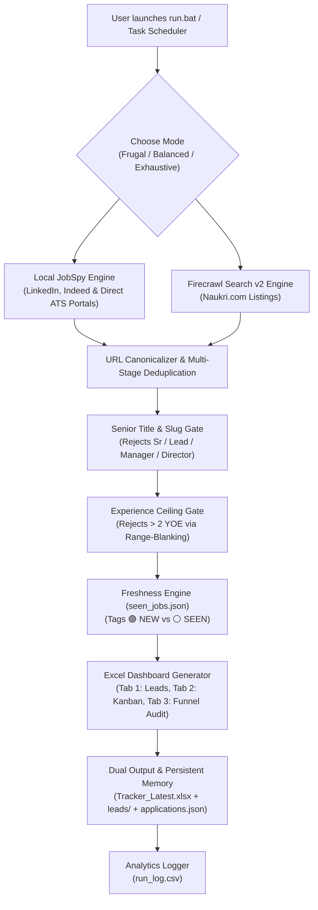

# 🎯 Automated Multi-Platform Job Hunter & Application Tracker

An automated job aggregation and tracking engine. It automatically discovers, validates, and filters job postings across **major platforms** (**LinkedIn, Indeed, and Naukri**), enriches listings with extracted skills, eliminates senior roles for 0–2 YOE freshers, tracks lead freshness, and builds a styled, interactive **Excel Application Dashboard** with native **"Apply Now"** buttons, persistent status/notes memory, and a full audit summary.

Includes a dedicated, isolated pipeline for **IT Support, Helpdesk & ServiceNow** roles across multiple locations (Hyderabad & Bengaluru).

---

## 📑 Table of Contents
- [How It Works](#-how-it-works)
- [How to Share This Tool with Friends](#-how-to-share-this-tool-with-friends)
- [Quick Start Guide (For You or a Friend)](#-quick-start-guide-for-you-or-a-friend)
- [Customizing Your Search (`config.yaml`)](#-customizing-your-search-configyaml)
- [Dedicated IT Support Pipeline (`run_it_support.bat`)](#-dedicated-it-support-pipeline)
- [Scraping Modes & Credit Budgeting](#-scraping-modes--credit-budgeting)
- [Understanding the Triple-Tab Excel Tracker](#-understanding-the-triple-tab-excel-tracker)
- [Automating Daily Sweeps (Windows Task Scheduler)](#-automating-daily-sweeps-windows-task-scheduler)
- [Architecture & File Reference](#-architecture--file-reference)
- [Testing & Production Verification](#-testing--production-verification)
- [Troubleshooting](#-troubleshooting)

---

## 🧠 How It Works



1. **Dual Scraping Engines**:
   - **JobSpy (Free, Local)**: Queries LinkedIn and Indeed directly with full description fetching for accurate skill matching, discovering direct corporate ATS application links (Workday, Greenhouse, Taleo) for free.
   - **Firecrawl Search v2 (Cloud)**: Targets direct Naukri listing paths with optional full markdown parsing to bypass anti-bot protections.
2. **Strict Quality Gating**:
   - Extracts real experience requirements from Naukri URL slugs (`-1-to-2-years-`) and description bodies.
   - Detects and drops senior listings (`Senior`, `Sr.`, `Lead`, `Manager`, `Architect`, `Principal`, `Director`).
   - Uses range-blanking in `_within_ceiling()` so upper bounds of valid ranges are never mistaken for minimums, rejecting bypasses like *"Graduate with 5-8 years"*.
   - Discards any job requiring $> 2$ years minimum experience.
3. **Freshness Tracking**:
   - Remembers previously seen jobs in `seen_jobs.json` with a 45-day rolling retention window.
   - New listings are highlighted as **`🟢 NEW`** (Bold Green).
   - Repeated listings from earlier runs are tagged as **`⚪ SEEN`** (Slate Gray).
   - Naukri listings older than 14 days decoded from URL slugs are automatically dropped.
4. **Interactive Triple-Tab Excel Output & Persistent Memory**:
   - Clickable native **"Apply Now"** buttons jump straight to the application page.
   - Application Status dropdowns (`Not Applied`, `Applied`, `Interviewing`, `Offer Received`, etc.).
   - **Persistent Memory**: Statuses and notes you enter in Excel are synchronized and preserved in `applications.json` across all future runs.
   - **Dual Output**: Generates both a timestamped archive in `leads/` (e.g. `leads/Job_Leads_2026-10-14_0110.xlsx`) and the stable desktop anchor `Tracker_Latest.xlsx`.
   - **Tab 2: Applied & In Progress**: Permanent Kanban board tracking active applications across all past and future runs.
   - **Tab 3: Run Summary**: Full audit table displaying raw candidates, filter drops, and credit consumption.
   - **Protected Against File Locks**: If open in Excel, saves safely to `_Latest.xlsx` without crashing.

---

## 🤝 How to Share This Tool with Friends

The pre-built **`JobHunter.zip`** in the root directory contains the clean, universal core Data Analyst pipeline.

When sharing this project or creating a custom package for a friend, follow these privacy rules:

### ✅ Core Package Files (Included in `JobHunter.zip`):
- `config.yaml` (their Data Analyst search configuration)
- `requirements.txt` (dependencies)
- `.env.example` (API key template)
- `extractor.py` (skills extraction logic)
- `scraper.py` (scraping engine)
- `excel_generator.py` (Excel builder)
- `main.py` (Data Analyst CLI orchestrator)
- `run.bat` (1-click interactive runner)
- `run_scheduled.bat` (headless scheduler runner)
- `tests/` (unit and regression test suite)
- `README.md` (this guide)
- `.gitignore` (prevents accidental credential leaks)

### 🌟 Optional IT Support & ServiceNow Module:
If your friend specifically targets **IT Support, Desktop Support, or ServiceNow roles**, also include:
- `config_it_support.yaml` (IT Support / ServiceNow configuration)
- `main_it_support.py` (Dedicated multi-location IT Support runner)
- `run_it_support.bat` (1-click IT Support runner)

### ⛔ NEVER Send These Files:
- **`.env`** (⚠️ Contains your private API key! Never share this file).
- `seen_jobs.json` / `seen_jobs_it_support.json` (Contains your personal run history).
- `applications.json` / `applications_it_support.json` (Your personal application notes).
- `run_log.csv` / `run_log_it_support.csv` (Your credit usage and run analytics).
- `Tracker_Latest.xlsx` / `leads/` (Your personal job leads).
- `__pycache__/` (Machine-specific compiled cache).

---

## ⚡ Quick Start Guide (For You or a Friend)

### Step 1: Install Python
Ensure Python 3.10+ (tested and verified up to Python 3.13) is installed.
- Download from [python.org](https://www.python.org/downloads/).
- **Important**: Check the box that says **"Add python.exe to PATH"** during installation.

### Step 2: Set Up API Keys (Optional but Recommended)
1. In the project folder, make a copy of `.env.example` and rename it to `.env`.
2. Get a free API key with 1,000 free credits from [Firecrawl.dev](https://www.firecrawl.dev).
3. Paste the key inside `.env`:
   ```env
   FIRECRAWL_API_KEY=fc-YOUR_API_KEY_HERE
   ```
> **Note**: If you don't provide an API key, the tool will gracefully skip Firecrawl and still scrape LinkedIn and Indeed for **100% free**!

### Step 3: Run the Tool!
- **Data Analyst Pipeline**: Just double-click **`run.bat`**.
  - Automatically verifies dependencies, displays the scraping mode countdown, and generates `Tracker_Latest.xlsx`.
- **IT Support Pipeline**: Just double-click **`run_it_support.bat`**.
  - Runs the multi-location sweep (Hyderabad + Bengaluru) and generates `Tracker_Latest_IT_Support.xlsx`.
- **Command Line**:
  ```bash
  py -m pip install -r requirements.txt
  py main.py --mode balanced
  ```

---

## ⚙️ Customizing Your Search (`config.yaml`)

Tailor the bot to your specific field, skills, or target city by editing [`config.yaml`](config.yaml):

```yaml
search:
  job_titles:
    - "Data Analyst"
    - "Data Annotator"
    - "SQL Developer"
    - "Power BI Developer"

  location: "Hyderabad"

  experience_filter: "0-2 years"
  max_experience_years: 2      # Strict ceiling: discard jobs requiring > 2 years

  # 24 hours for daily freshness, 72 hours for weekend catchup
  hours_old: 24

  results_wanted_per_role: 12

  platforms:
    - "linkedin"
    - "indeed"

  indeed_country: "india"

skills_filter:
  target_skills:
    - "SQL"
    - "Power BI"
    - "Python"
    - "Excel"
    - "Tableau"
    - "Data Cleaning"
    - "ETL"
```

---

## 🖥️ Dedicated IT Support Pipeline

For IT Support, Desktop Support, and ServiceNow roles:
- **Runner**: Double-click [`run_it_support.bat`](run_it_support.bat).
- **Configuration**: Edit [`config_it_support.yaml`](config_it_support.yaml).
- **Multi-Location**: Natively queries both **Hyderabad** and **Bengaluru**.
- **100% Isolated**: Uses its own `leads_it_support/` archive, `Tracker_Latest_IT_Support.xlsx`, `applications_it_support.json`, and `seen_jobs_it_support.json`. It will never touch or pollute your primary Data Analyst tracking database.

---

## 💳 Scraping Modes & Credit Budgeting

When launching [`run.bat`](run.bat), an interactive menu prompts for intensity:

```text
=====================================================================
Select Scraping Intensity for Today:
  [1] Balanced   (~24 credits) - Recommended: Full Markdown on top 4 listings
  [2] Frugal     (  8 credits) - Quick search scan
  [3] Exhaustive (~48 credits) - Deep Monday sweep
=====================================================================
Auto-selecting [1] in 5 seconds...
```

| Mode | Firecrawl Depth | Cost per Run (4 roles) | Ideal Usage |
| :--- | :--- | :--- | :--- |
| **Frugal** | Fast SERP snippet search (no page scrape) | **8 credits** (or 2 credits for 1 role) | Daily background sweeps via Task Scheduler (~240 credits/month). |
| **Balanced** | Full Markdown scrape on top 4 listings/role | **~24 credits** | Active application days where you want deep skill extraction. |
| **Exhaustive**| Full Markdown scrape on top 10 listings/role| **~48 credits** | Weekly Monday sweeps to capture the entire market. |

---

## 📊 Understanding the Triple-Tab Excel Tracker

Every run generates both:
1. **Timestamped Archive**: `leads/Job_Leads_YYYY-MM-DD_HHMM.xlsx`
2. **Stable Desktop Anchor**: `Tracker_Latest.xlsx`

### Tab 1: Active Job Leads
Contains 12 structured, interactive columns:

| Col # | Column Name | Format / Behavior |
| :---: | :--- | :--- |
| **A** | `Sl. No` | Sequential index (1, 2, 3...) |
| **B** | `Lead Status` | **`🟢 NEW`** (Emerald Bold) for fresh leads; **`⚪ SEEN`** (Slate Gray) for repeats. |
| **C** | `Date Posted` | Posting date or "Recent". |
| **D** | `Company Name` | Sanitized employer name. |
| **E** | `Job Title / Role` | Official designation. |
| **F** | `Main Skills Required`| Highlighted matching tech stack keywords. |
| **G** | `Experience Level` | Extracted range (e.g. `1 - 2 Years`, `Fresher`). |
| **H** | `Location / Mode` | Work model (`Hybrid`, `On-site`, `Remote`). |
| **I** | `Platform` | Source platform (`Naukri`, `LinkedIn`, `Indeed`, etc.). |
| **J** | `Apply Action` | **Clickable blue button** linking directly to the job post. |
| **K** | `Application Status` | **Interactive Dropdown**: `Not Applied`, `Applied`, `Interviewing`, `Rejected`, `Offer Received`. Preserved across runs! |
| **L** | `Referral / Notes` | Free-text space for tracking referrals, HR contacts, or follow-ups. Preserved across runs! |

### Tab 2: Applied & In Progress (Permanent Kanban View)
A dedicated view displaying every job you have marked as `Applied`, `Interviewing`, etc., or added notes to.
- Never disappears when tomorrow's fresh scrape runs.
- Includes **Sl. No**, **Company Name**, **Job Title**, **Location**, **Platform**, **View Job link**, **Application Status**, **Notes**, and **Last Updated**.
- Edits made on this sheet automatically sync back to `applications.json`!

### Tab 3: Run Summary
An audit sheet tracking funnel metrics for transparency:
- **Run Timestamp & Mode**
- **Total Raw Candidates Gathered** (Firecrawl + JobSpy)
- **Senior Roles Filtered**
- **Experience Ceiling Filtered (> 2 YOE)**
- **Final Verified Leads Retained**
- **Firecrawl Credits Consumed**

---

## ⏰ Automating Daily Sweeps (Windows Task Scheduler)

You can have Windows automatically run a silent Frugal scan every morning at 8:00 AM so fresh leads are ready when you wake up:

1. Open **Command Prompt** (or PowerShell).
2. Run this single command:
   ```cmd
   schtasks /create /tn "JobHunter" /tr "\"C:\path\to\job_automation\run_scheduled.bat\"" /sc daily /st 08:00
   ```
*(Replace `C:\path\to\job_automation` with your actual project directory path).*

- Uses [`run_scheduled.bat`](run_scheduled.bat), which includes automatic 5 MB log rotation, timestamp logging, and unbuffered execution.
- Runs in **Frugal mode** (costs only 8 credits/day = ~240/month, safely inside the 1,000 free monthly tier).

---

## 📁 Architecture & File Reference

```text
job_automation/
├── config.yaml               # User search configuration, skills, and mode parameters
├── config_it_support.yaml    # IT Support / ServiceNow configuration (Hyderabad & Bengaluru)
├── requirements.txt          # Pinned Python dependencies
├── .env.example              # Template for API keys
├── .env                      # [PRIVATE] Live Firecrawl API key
├── .gitignore                # Protects credentials, logs, and personal outputs
├── extractor.py              # Skill keyword matcher & experience/work-mode parser
├── scraper.py                # Dual engine orchestrator, ceiling filter, senior filter & seen ledger
├── excel_generator.py        # 12-column openpyxl builder with dropdowns, dual output, Tab 2 Kanban & Tab 3 audit
├── main.py                   # Data Analyst CLI entrypoint, credit delta checks & CSV migration logger
├── main_it_support.py        # Dedicated multi-location IT Support runner
├── run.bat                   # 1-Click interactive Data Analyst launcher with countdown
├── run_it_support.bat        # 1-Click interactive IT Support launcher
├── run_scheduled.bat         # Headless unattended runner with 5MB log rotation
├── Tracker_Latest.xlsx       # Stable desktop anchor for daily tracking
├── leads/                    # Timestamped historical archive folder (auto-generated)
├── seen_jobs.json            # Persistent URL ledger with 45-day rolling pruning
├── applications.json         # Persistent application status & notes ledger
├── run_log.csv               # Historical telemetry: timestamp, mode, credits, candidates, drops
└── tests/                    # Unit and regression test suite (41 passing tests)
    ├── test_phase2.py
    ├── test_refinements.py
    ├── test_experience_order.py
    └── test_nan_url.py
```

---

## 🧪 Testing & Production Verification

The entire codebase is verified by 41 automated unit and acceptance tests covering URL validation, date bounds, ceiling range-blanking, atomic persistence, formula injection protection, Kanban memory persistence, multi-tab sync, archive resurrection prevention, and multi-file sync precedence.

To run the complete test suite:
```powershell
py -m unittest discover tests -v
```

---

## 🛠️ Troubleshooting

### 1. "PermissionError: [Errno 13] Permission denied"
- **Cause**: An Excel file is currently open in Microsoft Excel while the script is running.
- **Solution**: The engine automatically catches this and saves a clean copy to `_Latest.xlsx` without crashing. Simply close Excel and your edits will sync on the next run.

### 2. Missing Dependencies
- Run:
  ```cmd
  py -m pip install -r requirements.txt
  ```

---

## 🎯 Final Pro-Tip for Landing the Offer
1. **Apply within the first 24 hours**: Filter for `🟢 NEW` every morning. The earliest applicants get reviewed first.
2. **Use Autofill Extensions**: Install tools like *Simplify Copilot* in Chrome/Edge. When you click **"Apply Now"** from Excel, it will pre-fill complex Workday/Taleo applications in seconds.
3. **Follow-Up**: Note the HR or hiring manager in Column L (`Referral / Notes`) and reach out on LinkedIn.
