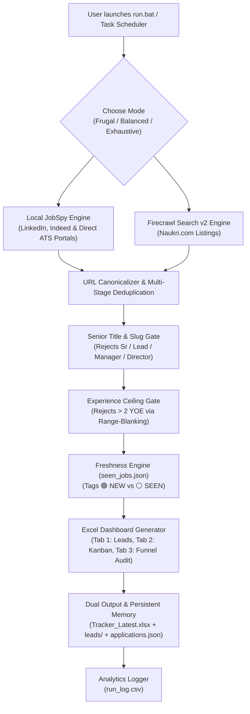

# 🛡️ Project Heimdall: Automated Multi-Platform Job Hunter & Application Tracker


[](https://github.com/harsha71018/Project-Heimdall/actions/workflows/tests.yml)


> **Project Heimdall** acts as the all-seeing gatekeeper for your job hunt—scanning across LinkedIn, Indeed, Naukri, and corporate ATS portals, blocking senior/expired roles at the gate, and syncing verified 0–2 YOE leads into a bi-directional 3-tab Excel command center.

An automated job aggregation and tracking engine. It automatically discovers, validates, and filters job postings across **major platforms** (**LinkedIn, Indeed, and Naukri**), enriches listings with extracted skills, eliminates senior roles for 0–2 YOE freshers, tracks lead freshness, and builds a styled, interactive **Excel Application Dashboard** with native **"Apply Now"** buttons, persistent status/notes memory, and a full audit summary.

---

## 📑 Table of Contents
- [⚠️ Default Profile Notice](#-default-profile-notice-customization-first-steps)
- [🌐 Supported Platforms & Zero-Cost Breakdown](#-supported-platforms--zero-cost-breakdown)
- [How It Works](#-how-it-works)
- [Quick Start Guide (Windows, macOS, Linux)](#-quick-start-guide-for-you-or-a-friend)
- [How to Customize for Your Own Role & City](#-how-to-customize-for-your-own-role--city)
- [Scraping Modes & Credit Budgeting](#-scraping-modes--credit-budgeting)
- [Understanding the Triple-Tab Excel Tracker](#-understanding-the-triple-tab-excel-tracker)
- [Automating Daily Sweeps (Windows Task Scheduler & macOS Cron)](#-automating-daily-sweeps-windows-task-scheduler--macos-cron)
- [Architecture & Tech Stack](#-architecture--file-reference)
- [How to Share This Tool with Friends](#-how-to-share-this-tool-with-friends)
- [Testing & Production Verification](#-testing--production-verification)
- [Troubleshooting](#-troubleshooting)

---

## ⚠️ Default Profile Notice (Customization First-Steps)

> [!IMPORTANT]
> **Out-of-the-Box Configuration:**
> This repository ships pre-configured with the author's target job search profile:
> * **Roles:** Data Analyst, Data Annotator, SQL Developer, Power BI Developer
> * **Location:** Hyderabad, India (with Remote support)
> * **Experience Level:** 0–2 Years of Experience (Entry-Level / Fresher)
> * **Tracked Skills:** SQL, Power BI, Python, Excel, Tableau, DAX
>
> **Project Heimdall is 100% role-agnostic.** If you are a **Software Engineer, DevOps Specialist, ServiceNow Developer, or Product Manager**, you **do NOT need to write new scraping code**. You can customize the entire pipeline in under 60 seconds by editing `config.yaml` or passing CLI flags.

---

## 🌐 Supported Platforms & Zero-Cost Breakdown

Project Heimdall operates on a hybrid scraping architecture designed to be **100% free to run indefinitely**, with an optional high-octane API mode for deeper portal crawling:

| Platform | Engine | Cost & API Key Requirement | Included In |
| :--- | :--- | :--- | :--- |
| **LinkedIn** | `JobSpy` | **100% Free** — No account, no API key required | All Modes (`frugal`, `balanced`, `exhaustive`) |
| **Indeed** | `JobSpy` | **100% Free** — No account, no API key required | All Modes (`frugal`, `balanced`, `exhaustive`) |
| **Naukri.com** | `Firecrawl Search v2` | **Free Tier** (1,000 free credits/month; 8 credits/run in frugal mode with key, or 0 credits without key) | `frugal` (snippet search), `balanced`, `exhaustive` |
| **Glassdoor / ZipRecruiter** | `JobSpy` | **100% Free** — Optional toggle via `search.platforms` in `config.yaml` | Optional |

> [!NOTE]
> **Enterprise ATS Direct Links:** Direct application links (Workday, Greenhouse, Lever, Taleo, etc.) are recognized and validated when surfaced by JobSpy through aggregator listings; Firecrawl itself targets Naukri listings.

> [!TIP]
> **Zero-Cost Operation without API Key:**
> If you don't provide a Firecrawl API key in `.env` (or set `firecrawl.enabled: false`), Project Heimdall runs exclusively on **LinkedIn and Indeed** with **zero cost, zero tokens, and zero API keys needed**.

---

## 🧠 How It Works



1. **Dual Scraping Engines**:
   - **JobSpy (Free, Local)**: Queries LinkedIn and Indeed directly with full description fetching for accurate skill matching, discovering direct corporate ATS application links (Workday, Greenhouse, Taleo) for free.
   - **Firecrawl Search v2 (Cloud)**: Targets direct Naukri listing paths with optional full markdown parsing to bypass anti-bot protections.
2. **Strict Quality Gating**:
   - Extracts real experience requirements from Naukri URL slugs (`-1-to-2-years-`) and description bodies.
   - Detects and drops senior listings (`Senior`, `Sr.`, `Lead`, `Manager`, `Architect`, `Principal`, `Director`).
   - Uses range-blanking in `_within_ceiling()` so upper bounds of valid ranges are never mistaken for minimums, rejecting bypasses like *"Graduate with 5-8 years"*.
   - Discards any job requiring $> 2$ years minimum experience.
3. **Freshness Tracking**:
   - Remembers previously seen jobs in `seen_jobs.json` with a 45-day rolling retention window.
   - New listings are highlighted as **`🟢 NEW`** (Bold Green).
   - Repeated listings from earlier runs are tagged as **`⚪ SEEN`** (Slate Gray).
   - Naukri listings older than 14 days decoded from URL slugs are automatically dropped.
4. **Interactive Triple-Tab Excel Output & Persistent Memory**:
   - Clickable native **"Apply Now"** buttons jump straight to the application page.
   - Application Status dropdowns (`Not Applied`, `Applied`, `Interviewing`, `Offer Received`, etc.).
   - **Persistent Memory**: Statuses and notes you enter in Excel are synchronized and preserved in `applications.json` across all future runs.
   - **Dual Output**: Generates both a timestamped archive in `leads/` (e.g. `leads/Job_Leads_2026-10-14_0110.xlsx`) and the stable desktop anchor `Tracker_Latest.xlsx`.
   - **Tab 2: Applied & In Progress**: Permanent Kanban board tracking active applications across all past and future runs.
   - **Tab 3: Run Summary**: Full audit table displaying raw candidates, filter drops, and credit consumption.
   - **Protected Against File Locks**: If open in Excel, saves safely to `_Latest.xlsx` without crashing.

---

## 🤝 How to Share This Tool with Friends

The distributable **`Project-Heimdall.zip`** can be built locally (gitignored to keep the repo lightweight) containing the clean, universal core Data Analyst pipeline.

When sharing this project or creating a custom package for a friend, follow these privacy rules:

### ✅ Core Package Files (Included in `Project-Heimdall.zip`):
- `config.yaml` (their Data Analyst search configuration)
- `requirements.txt` (dependencies)
- `.env.example` (API key template)
- `.gitignore` (prevents accidental credential leaks)
- `LICENSE` (MIT License)
- `CHANGELOG.md` (version history & release notes)
- `url_utils.py` (shared URL canonicalizer & identity query isolation)
- `extractor.py` (skills extraction logic)
- `scraper.py` (scraping engine)
- `excel_generator.py` (Excel builder)
- `main.py` (Data Analyst CLI orchestrator)
- `run.bat` (1-click interactive runner)
- `run_scheduled.bat` (headless scheduler runner)
- `README.md` (this guide)
- `tests/` (unit and regression test suite)

### ⛔ NEVER Share These Files:
- **`.env`** (⚠️ Contains your private API key! Never share this file).
- `seen_jobs*.json` (Contains your personal run history).
- `applications*.json` (Your personal application notes).
- `run_log*.csv` (Your credit usage and run analytics).
- `Tracker_Latest*.xlsx` / `leads/` (Your personal job leads).
- `__pycache__/` (Machine-specific compiled cache).

---

## ⚡ Quick Start Guide (For You or a Friend)

### Step 1: Install Python
Ensure Python 3.10+ (tested and verified up to Python 3.13) is installed.
- Download from [python.org](https://www.python.org/downloads/).
- **Important**: Check the box that says **"Add python.exe to PATH"** during installation.

### Step 2: Set Up API Keys (Optional but Recommended)
1. In the project folder, make a copy of `.env.example` and rename it to `.env`.
2. Get a free API key with 1,000 free credits/month from [Firecrawl.dev](https://www.firecrawl.dev).
3. Paste the key inside `.env`:
   ```env
   FIRECRAWL_API_KEY=fc-YOUR_API_KEY_HERE
   ```
> **Note**: If you don't provide an API key, the tool will gracefully skip Firecrawl and still scrape LinkedIn and Indeed for **100% free**!

### Step 3: Run the Tool!

#### 🪟 On Windows:
- **1-Click Launch**: Double-click **`run.bat`**.
  - Automatically verifies dependencies, displays the scraping mode countdown, and writes `Tracker_Latest.xlsx`.
- **Command Line**:
  ```cmd
  py -m pip install -r requirements.txt
  py main.py --mode balanced
  ```

#### 🍎 On macOS & Linux:
Project Heimdall runs natively on macOS (Intel & Apple Silicon) and Linux:
```bash
# 1. Clone repository
git clone https://github.com/harsha71018/Project-Heimdall.git
cd Project-Heimdall

# 2. Set up virtual environment
python3 -m venv venv
source venv/bin/activate

# 3. Install requirements
pip install -r requirements.txt

# 4. Launch Heimdall
python3 main.py --mode balanced
```
*Note: The generated `.xlsx` spreadsheets open seamlessly in **Microsoft Excel for Mac**, **Apple Numbers**, or **Google Sheets**.*

---

## ⚙️ How to Customize for Your Own Role & City

You can tailor Project Heimdall to any tech stack, city, or experience level across three tiers:

### Tier 1: Configuration File (`config.yaml`) — *No Python Knowledge Needed*
Edit [`config.yaml`](config.yaml) to match your exact career path:

```yaml
search:
  # 1. Target Job Titles
  job_titles:
    - "Java Developer"
    - "Backend Engineer"
    - "Spring Boot Developer"

  # 2. Target City or "Remote"
  location: "Bengaluru"

  # 3. Experience Ceiling (in years)
  # NOTE: Setting max_experience_years > 2 automatically disables the Fresher/Junior Title Gate!
  max_experience_years: 4

  # 4. Target Country for Indeed (india, usa, uk, canada, etc.)
  indeed_country: "india"

  # 5. Lookback Window (24 hours for daily sweeps, 72 for weekend catchup)
  hours_old: 24

skills_filter:
  # 6. Tech stack keywords (matches are auto-highlighted in Excel Column F)
  target_skills:
    - "Java"
    - "Spring Boot"
    - "Microservices"
    - "Docker"
    - "Kubernetes"
    - "AWS"
```

### Tier 2: Quick Command-Line Overrides
Perform instant one-off sweeps for a different role, location, or timeframe without modifying `config.yaml`:
```bash
# Windows
py main.py --role "DevOps Engineer" --location "Pune" --hours 48 --mode frugal

# macOS / Linux
python3 main.py --role "Python Developer" --location "Remote" --hours 24 --mode balanced
```

### Tier 3: Advanced Portals & Regional Filters (`scraper.py`)
For advanced users targeting non-metro cities or proprietary company career portals:
- **Regional Cities:** If searching Tier-2 cities (e.g. *Kochi, Indore, Coimbatore, Jaipur*), add the city name to `KNOWN_CITIES` in `scraper.py` so Naukri company names are cleanly parsed from URL slugs.
- **Role Keywords:** If searching niche roles like DevOps or QA, add keywords to `ROLE_KEYWORDS` in `scraper.py` to keep company names pristine.
- **Custom Enterprise ATS:** Add specific corporate job board domains to `KNOWN_ATS_JOB_PATTERNS` or `KNOWN_ENTERPRISE_PORTALS` in `scraper.py` to whitelist proprietary company portals.

---

## 💳 Scraping Modes & Credit Budgeting

When launching [`run.bat`](run.bat), an interactive menu prompts for intensity:

```text
=====================================================================
Select Scraping Intensity for Today:
  [1] Balanced   (~24 credits) - Recommended: Full Markdown on top 4 listings
  [2] Frugal     (  8 credits) - Quick search scan
  [3] Exhaustive (~48 credits) - Deep Monday sweep
=====================================================================
Auto-selecting [1] in 5 seconds...
```

| Mode | Firecrawl Depth | Cost per Run (4 roles) | Ideal Usage |
| :--- | :--- | :--- | :--- |
| **Frugal** | Fast SERP snippet search (no page scrape) | **8 credits** (or 2 credits for 1 role) | Daily background sweeps via Task Scheduler (~240 credits/month). |
| **Balanced** | Full Markdown scrape on top 4 listings/role | **~24 credits** | Active application days where you want deep skill extraction. |
| **Exhaustive**| Full Markdown scrape on top 10 listings/role| **~48 credits** | Weekly Monday sweeps to capture the entire market. |

---

## 📊 Understanding the Triple-Tab Excel Tracker

Every run generates both:
1. **Timestamped Archive**: `leads/Job_Leads_YYYY-MM-DD_HHMM.xlsx`
2. **Stable Desktop Anchor**: `Tracker_Latest.xlsx`

### Tab 1: Active Job Leads
Contains 12 structured, interactive columns:

| Col # | Column Name | Format / Behavior |
| :---: | :--- | :--- |
| **A** | `Sl. No` | Sequential index (1, 2, 3...) |
| **B** | `Lead Status` | **`🟢 NEW`** (Emerald Bold) for fresh leads; **`⚪ SEEN`** (Slate Gray) for repeats. |
| **C** | `Date Posted` | Posting date or "Recent". |
| **D** | `Company Name` | Sanitized employer name. |
| **E** | `Job Title / Role` | Official designation. |
| **F** | `Main Skills Required`| Highlighted matching tech stack keywords. |
| **G** | `Experience Level` | Extracted range (e.g. `1 - 2 Years`, `Fresher`). |
| **H** | `Location / Mode` | Work model (`Hybrid`, `On-site`, `Remote`). |
| **I** | `Platform` | Source platform (`Naukri`, `LinkedIn`, `Indeed`, etc.). |
| **J** | `Apply Action` | **Clickable blue button** linking directly to the job post. |
| **K** | `Application Status` | **Interactive Dropdown**: `Not Applied`, `Applied`, `Referral Requested`, `Screening Call`, `Interviewing`, `Assessment`, `Rejected`, `Offer Received`. Preserved across runs! |
| **L** | `Referral / Notes` | Free-text space for tracking referrals, HR contacts, or follow-ups. Preserved across runs! |

### Tab 2: Applied & In Progress (Permanent Kanban View)
A dedicated view displaying every job you have marked as `Applied`, `Interviewing`, etc., or added notes to.
- Never disappears when tomorrow's fresh scrape runs.
- Includes **Sl. No**, **Company Name**, **Job Title**, **Location**, **Platform**, **View Job link**, **Application Status**, **Notes**, and **Last Updated**.
- Edits made on this sheet automatically sync back to `applications.json`!

### Tab 3: Run Summary
An audit sheet tracking funnel metrics for transparency:
- **Run Timestamp & Mode**
- **Total Raw Candidates Gathered** (Firecrawl + JobSpy)
- **Senior Roles Filtered**
- **Experience Ceiling Filtered (> 2 YOE)**
- **Final Verified Leads Retained**
- **Firecrawl Credits Consumed**

---

## ⏰ Automating Daily Sweeps (Windows Task Scheduler & macOS Cron)

### 🪟 Windows (Task Scheduler)
You can have Windows automatically run a silent Frugal scan every morning at 8:00 AM so fresh leads are ready when you wake up:

1. Open **Command Prompt** (or PowerShell).
2. Run this single command:
   ```cmd
   schtasks /create /tn "Project-Heimdall" /tr "\"C:\path\to\Project-Heimdall\run_scheduled.bat\"" /sc daily /st 08:00
   ```
*(Replace `C:\path\to\Project-Heimdall` with your actual project directory path).*

- Uses [`run_scheduled.bat`](run_scheduled.bat), which includes automatic 5 MB log rotation, timestamp logging, and unbuffered execution.
- Runs in **Frugal mode** (costs only 8 credits/day = ~240/month, safely inside the 1,000 free monthly tier).

### 🍎 macOS & Linux (`cron`)
To schedule Project Heimdall to run automatically at 8:00 AM every day on macOS or Linux:

1. Open your terminal and edit your crontab:
   ```bash
   crontab -e
   ```
2. Add this single cron entry:
   ```bash
   0 8 * * * cd /path/to/Project-Heimdall && ./venv/bin/python3 main.py --mode balanced >> run.log 2>&1
   ```
*(Replace `/path/to/Project-Heimdall` with your actual project path).*

---

## 📁 Architecture & File Reference

```text
Project-Heimdall/
├── .github/                  # GitHub Actions CI workflow (Python 3.10-3.13 matrix)
├── config.yaml               # User search configuration, skills, and mode parameters
├── requirements.txt          # Python dependency requirements (tested minimum bounds)
├── .env.example              # Template for API keys
├── .env                      # [PRIVATE] Live Firecrawl API key
├── .gitignore                # Protects credentials, logs, and personal outputs
├── LICENSE                   # Open-source MIT License
├── CHANGELOG.md              # Detailed version history and release audit log
├── url_utils.py              # Shared URL canonicalizer & identity query isolation
├── extractor.py              # Skill keyword matcher & experience/work-mode parser
├── scraper.py                # Dual engine orchestrator, ceiling filter, senior filter & seen ledger
├── excel_generator.py        # 12-column openpyxl builder with dropdowns, dual output, Tab 2 Kanban & Tab 3 audit
├── main.py                   # CLI orchestrator, credit delta checks & CSV migration logger
├── run.bat                   # 1-Click interactive launcher with countdown
├── run_scheduled.bat         # Headless unattended runner with 5MB log rotation
├── Tracker_Latest.xlsx       # Stable desktop anchor for daily tracking
├── leads/                    # Timestamped historical archive folder (auto-generated)
├── seen_jobs.json            # Persistent URL ledger with 45-day rolling pruning
├── applications.json         # Persistent application status & notes ledger
├── run_log.csv               # Historical telemetry: timestamp, mode, credits, candidates, drops
└── tests/                    # Unit and regression test suite (44 passing tests)
    ├── test_phase2.py
    ├── test_refinements.py
    ├── test_experience_order.py
    └── test_nan_url.py
```

### 📦 Required Libraries & Tech Stack

| Dependency | Purpose | Why It Was Chosen |
| :--- | :--- | :--- |
| `python-jobspy` | Multi-platform TLS scraping across LinkedIn & Indeed | Bypasses basic bot gates without browser overhead or paid APIs. |
| `pandas` | In-memory tabular deduplication & transformations | High-speed deduplication across candidate dataframes and CSV export. |
| `openpyxl` | Dynamic Excel dashboard generation | Native conditional formatting, cell dropdown validation, formula protection, and multi-sheet preservation. |
| `pyyaml` | Configuration parser | Clean, human-readable settings structure for zero-code user customization. |
| `requests` | Resilient HTTP transport | Handles REST communication with Firecrawl API with a single retry honouring the API's Retry-After header. |
| `python-dotenv` | Local environment security | Zero-leak isolation of private API credentials from git tracking. |

---

## 🧪 Testing & Production Verification

The entire codebase is verified by 44 automated unit and acceptance tests covering URL validation, date bounds, ceiling range-blanking, atomic persistence, formula injection protection, hidden provenance stamps, Kanban memory persistence, multi-tab sync, archive resurrection prevention, and multi-file sync precedence.

To run the complete test suite:
```powershell
py -m unittest discover tests -v
```

---

## 🛠️ Troubleshooting

### 1. "PermissionError: [Errno 13] Permission denied"
- **Cause**: An Excel file is currently open in Microsoft Excel while the script is running.
- **Solution**: The engine automatically catches this and saves a clean copy to `_Latest.xlsx` without crashing. Simply close Excel and your edits will sync on the next run.

### 2. Missing Dependencies
- Run:
  ```cmd
  py -m pip install -r requirements.txt
  ```

---

## 🎯 Final Pro-Tip for Landing the Offer
1. **Apply within the first 24 hours**: Filter for `🟢 NEW` every morning. The earliest applicants get reviewed first.
2. **Use Autofill Extensions**: Install tools like *Simplify Copilot* in Chrome/Edge. When you click **"Apply Now"** from Excel, it will pre-fill complex Workday/Taleo applications in seconds.
3. **Follow-Up**: Note the HR or hiring manager in Column L (`Referral / Notes`) and reach out on LinkedIn.

---

## ⚖️ License & Disclaimer

### License
This project is licensed under the [MIT License](LICENSE) - see the LICENSE file for details.

### Disclaimer
Project Heimdall scrapes publicly reachable job pages for personal job-search use. LinkedIn and Indeed prohibit automated scraping in their Terms of Service and may block your IP — use it at your own risk and keep the request rate low. When the Firecrawl engine is enabled, your search queries (role + city) are sent to Firecrawl's cloud API; JobSpy traffic stays on your machine.
