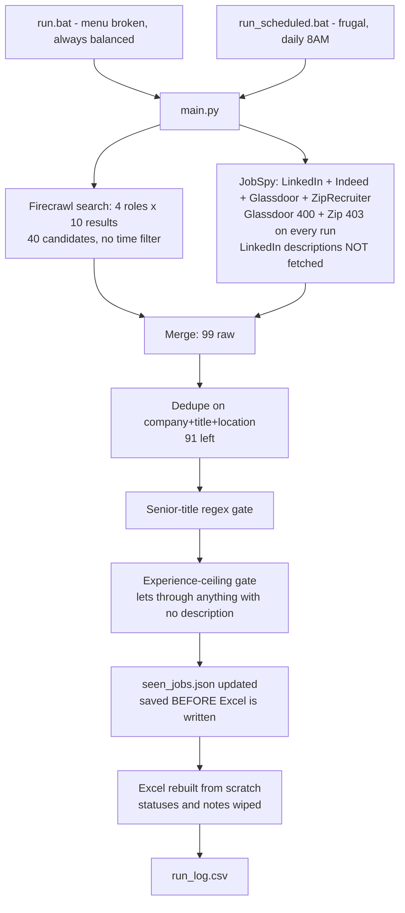
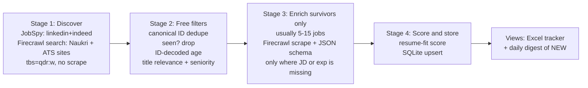

# Job Hunter Pipeline — Deep Audit

**Scope:** every file in `job_automation/`, plus the **real output** of the last run: [Job_Applications_Tracker.xlsx](file:///d:/ANTIGRAVITY%20WORKSPACE/job_automation/Job_Applications_Tracker.xlsx), [run_log.csv](file:///d:/ANTIGRAVITY%20WORKSPACE/job_automation/run_log.csv), [scheduled_run.log](file:///d:/ANTIGRAVITY%20WORKSPACE/job_automation/scheduled_run.log) and [seen_jobs.json](file:///d:/ANTIGRAVITY%20WORKSPACE/job_automation/seen_jobs.json).

## TL;DR

The structure is solid: two engines, dedupe, filter gates, a list of jobs you've already seen, and an Excel file. Config-driven, it fails gracefully, and it tracks credits. Credit to you for that.

But **the tool doesn't deliver what it promises yet**. It calls itself an *application tracker*, a *freshness engine* and a *strict quality gate*. The data from your last run shows otherwise:

| Promise | Reality (measured on your 50-row output) |
|---|---|
| "Application Tracker" | Every run **deletes your Status and Notes columns** (it rebuilds the workbook from scratch). The 8 AM scheduled task does this every day. |
| "Fresh listings (72h)" | **7 of 9** Naukri rows are 2+ months old; **3 are from 2021–2022**. Firecrawl ignores `hours_old` completely. |
| "Strict experience gate" | **34/50** rows have `Not Specified` experience, so the gate **lets them all through**. Root cause: LinkedIn descriptions are never fetched. |
| "Extracted skills" | **34/50** rows show the made-up fallback `"Data Analysis, Problem Solving"`. |
| "Pick a mode" menu | `run.bat` **always runs Balanced**, whatever you press. |
| "Status dropdown" | The dropdown arrow is **hidden** (openpyxl flag works the opposite way you'd expect). |

The code mostly works. The real problems are in **what goes into the gates** and **how state is kept between runs**.

---

## 1. The pipeline as it actually runs

Numbers are from the 2026-09-29 11:50 frugal run:



---

## 2. Critical bugs (P0): fix these first

### 2.1 Excel rebuild deletes your application history
[excel_generator.py L36](file:///d:/ANTIGRAVITY%20WORKSPACE/job_automation/excel_generator.py#L36) calls `openpyxl.Workbook()` (a brand-new file) and [L123](file:///d:/ANTIGRAVITY%20WORKSPACE/job_automation/excel_generator.py#L123) writes `"Not Applied"` into every row. Say you mark 10 jobs "Applied" and add referral notes. Tomorrow at 8 AM the scheduled run overwrites all of it.

It gets worse with `_safe_save`. If the file is open, the run writes `_Latest.xlsx` instead. That leaves two diverging files (you have both right now). And jobs that dropped out of the search window **disappear from your tracker**, even ones you applied to.

**Fix:** make the tracker **append-and-merge**, not rebuild:
1. Give each job a stable key (see 3.2).
2. Load the existing workbook and read `{key: (status, notes)}`.
3. Add only new keys. Never touch K/L for keys that already exist. Never delete rows (archive them to a second sheet).

Better long-term: store the data in **SQLite** and treat Excel as a *view* you regenerate from it (see section 5).

### 2.2 `run.bat` mode menu always picks Balanced
[run.bat L29-31](file:///d:/ANTIGRAVITY%20WORKSPACE/job_automation/run.bat#L29-L31): `if errorlevel N` means **≥ N**. All three lines run in order, so the last one (`errorlevel 1 → balanced`) always wins. Your `run_log.csv` confirms it: every interactive run says `balanced`, and the only `frugal` run came from `run_scheduled.bat`.

```bat
if errorlevel 3 (set MODE=exhaustive) else if errorlevel 2 (set MODE=frugal) else (set MODE=balanced)
```

### 2.3 Firecrawl returns stale, probably expired jobs
Two things combine here:
- [scraper.py L247-250](file:///d:/ANTIGRAVITY%20WORKSPACE/job_automation/scraper.py#L247-L250) sends no time filter. Firecrawl search **supports `tbs`** (`qdr:d` = 24h, `qdr:w` = week, verified in their docs), plus a `location` parameter.
- [L317](file:///d:/ANTIGRAVITY%20WORKSPACE/job_automation/scraper.py#L317) hardcodes `date_posted: "Recent"`. That hides how old the jobs are.

**Evidence:** Naukri job IDs seem to start with the posting date as `DDMMYY`. All 9 of your Naukri URLs decode to valid dates:

| Listing | Decoded posting date |
|---|---|
| navayuga-infotech … `041021`500967 | **2021-10-04** |
| eteam-inc … `180822`501630 | **2022-08-18** |
| talentas-technology … `041022`500913 | **2022-10-04** |
| vaillant-diligent … `170524`501566 | 2024-05-17 |
| proounce-solutions … `111024`500022 | 2024-10-11 |
| orcapod … `150225`005334 | 2025-02-15 |
| s-s-enterprise … `170225`503398 | 2025-02-17 |
| franklin-templeton … `050826`505118 | 2026-08-05 |
| amazon … `070826`025596 | 2026-08-07 |

LinkedIn shows the same thing: Firecrawl's LinkedIn IDs (`4010428300`, `4304829196`) are far lower than JobSpy's fresh `447xxxxxxx` IDs. LinkedIn IDs only ever increase, so lower means older.

**Fix:** add `"tbs": "qdr:w"` and drop Naukri rows whose decoded date is older than `hours_old`:

```python
def _naukri_posted_date(self, url: str) -> Optional[datetime]:
    m = re.search(r'-(\d{6})\d{4,8}$', url)
    if not m:
        return None
    try:
        return datetime.strptime(m.group(1), "%d%m%y")
    except ValueError:
        return None
```
> [!NOTE]
> I inferred the DDMMYY pattern from your data (9 out of 9 URLs gave valid dates). Naukri doesn't document it. Use it as a filter signal, but if a date doesn't parse, skip the filter rather than dropping the job.

### 2.4 LinkedIn descriptions are never fetched, so the gates have nothing to check
[scraper.py L178-186](file:///d:/ANTIGRAVITY%20WORKSPACE/job_automation/scraper.py#L178-L186) calls `scrape_jobs` without `linkedin_fetch_description=True`. In your installed JobSpy 1.1.82 that flag defaults to `False`. So for LinkedIn rows:
- the description is empty → no skills → fallback text
- experience is `Not Specified` → [`_within_ceiling`](file:///d:/ANTIGRAVITY%20WORKSPACE/job_automation/scraper.py#L465-L488) returns `True` → **the job passes the gate unchecked**
- `job_url_direct` is empty, so you never get the company's own ATS link

That is why 34/50 rows have no skills and no experience. Your filter only *looks* strict. For LinkedIn rows it is really a title regex and nothing else.

**Fix:** set `linkedin_fetch_description=True`. It's slower (one request per job), so keep `results_wanted` around 15–20.

### 2.5 The status dropdown is hidden
[excel_generator.py L166](file:///d:/ANTIGRAVITY%20WORKSPACE/job_automation/excel_generator.py#L166): `showDropDown=True`. In openpyxl this field is literally aliased as `hide_drop_down` (checked in your installed source). The OOXML spec defines it as "suppress the in-cell dropdown". **Remove the argument** (or set it to `False`).

---

## 3. Data-quality defects (P1)

### 3.1 Company names guessed from URL slugs are often wrong
Slug parsing ([L383-407](file:///d:/ANTIGRAVITY%20WORKSPACE/job_automation/scraper.py#L383-L407)) produced these in your current tracker:

| Shown as Company | Actual |
|---|---|
| `Enterprise Relationship Mgmt Franklin Templeton Asset Management India Pvt` | Franklin Templeton |
| `Oracle Pl Sql Developer Proounce Solutions Private Limited` | Proounce Solutions |
| `S Enterprise` | S S Enterprise (the token dedupe removed the second "s") |
| `No`, `Information Technology` | parsing error on LinkedIn slug |
| Role: `Power Bi Developer Jobs In India` | title cleanup failed |

A URL slug is lossy, so the heuristic can't be fixed. The SERP `title` usually has a clean `Role - Company - City` structure. Better still, for the few jobs that survive filtering, use **Firecrawl `/scrape` with a JSON schema** (`company`, `title`, `min_exp`, `max_exp`, `location`, `posted_date`, `skills[]`). Structured extraction replaces about 120 lines of regex.

### 3.2 Dedupe and the seen-jobs list never match across engines
- Firecrawl rows get the **search** location (`"Hyderabad"`, [L312](file:///d:/ANTIGRAVITY%20WORKSPACE/job_automation/scraper.py#L312)). JobSpy rows get `"Hyderabad, Telangana, India"`. Since dedupe keys on `company+title+location` ([L509](file:///d:/ANTIGRAVITY%20WORKSPACE/job_automation/scraper.py#L509)), **the same job from both engines never merges**. Even inside JobSpy, `SME Careers / Telugu Language Expert` shows up twice (rows 44–45) because one location string is shorter.
- `keep='first'` keeps the **Firecrawl** copy. That's the worse one: guessed company, no date, fake location.
- [seen_jobs](file:///d:/ANTIGRAVITY%20WORKSPACE/job_automation/scraper.py#L547) uses the full URL as its key. LinkedIn comes back as both `in.linkedin.com/jobs/view/data-analyst-at-x-4397229737` and `www.linkedin.com/jobs/view/4471309557`, so the same job gets two keys.

**Fix:** use one canonical ID everywhere: `(platform, native_job_id)`, e.g. `linkedin:4397229737`, `naukri:041022500913`, `indeed:20fe4c9ec59827dd`. Dedupe on that first, then use a normalized (company, title) match as a backup. Pick the row with the most information (has a description and a date), not the first one.

### 3.3 Experience extractor checks keywords in the wrong order
[extractor.py L52](file:///d:/ANTIGRAVITY%20WORKSPACE/job_automation/extractor.py#L52) checks fresher/intern keywords **before** numeric ranges. So a JD saying *"5+ years required… you will mentor interns"* gets classified as **Entry**. Also, the first `\d+ years` match anywhere wins, so *"a company with 25 years of history"* counts as an experience requirement.

**Fix:** look for explicit ranges first, and only near words like "experience" (within about 40 characters). Use fresher keywords only as a fallback.

### 3.4 Seniority gate misses level suffixes
`Data Analyst III` (F5), `Catalogue Analyst III`, `Business Analyst II`, `Business Analyst L3` all passed. Level II/III usually means 3–6 years. Add `\b(II|III|IV|L[3-9]|staff)\b` to `SENIOR_TITLE_PATTERN`. Separately, `Orcapod 2–6 yrs` and `Navayuga 1–6 yrs` pass because only the *minimum* is checked. Consider also requiring `max ≤ ceiling + 3`.

### 3.5 No relevance filter
LinkedIn's fuzzy search fills your "Data Analyst" results with: *Customer Service New Associate, Telugu Language Expert ×2, Trust & Safety New Associate, Online Data Analyst Urdu, Imaging Specialist DXA, Associate Content Specialist, Automation Testing Consultant*. That's about **20% noise**. Add a relevance score: overlap between title tokens and target-role tokens, plus a negative-keyword list (`customer service`, `language expert`, `sales`, `testing`…).

### 3.6 The fallback text makes up data
[extractor.py L94](file:///d:/ANTIGRAVITY%20WORKSPACE/job_automation/extractor.py#L94) writes `"Data Analysis, Problem Solving"` when nothing matched. An empty value tells the truth. Made-up text misleads you, and it hid the LinkedIn description bug (2.4) for this long. Show `—` or `(no JD)` instead.

### 3.7 Two platforms fail on every run
`scheduled_run.log`: **ZipRecruiter 403** (it only covers US/Canada, so it will never work for India) and **Glassdoor 400 "location not parsed"** on all 4 roles. Remove `zip_recruiter`. Glassdoor may work with a location like `"Hyderabad, Telangana"` (not tested), or drop it.

> [!WARNING]
> **Correction (live test, 2026-10-04 22:09).** An earlier version of this audit said to "add `naukri` and `google`" because they appear in JobSpy's `Site` enum. **I tested them and they don't work from your machine:**
> - `naukri` → **HTTP 406 `"recaptcha required"`**, 0 rows
> - `google` → **0 rows**, both with `search_term` and with `google_search_term`
> - `linkedin` + `linkedin_fetch_description=True` → **8/8 descriptions, 7/8 dates** ✅ (this confirms 2.4)
>
> So Firecrawl is currently your **only working Naukri source**. Keep it.

---

## 4. Architecture and cost

~~JobSpy already reaches Naukri for free.~~ **Wrong. See the correction in 3.7.** The one real overlap: Firecrawl also queries `site:linkedin.com/jobs/view`, which JobSpy already covers better (fresher, with descriptions once 2.4 is fixed). **Remove LinkedIn from the Firecrawl query and spend those credits on Naukri plus company career sites (ATS).**

Telemetry on the modes:

| Mode | Limit/role | Credits | FC candidates | FC retained | Markdown hits |
|---|---|---|---|---|---|
| balanced (×4 runs) | 4 | 4–6 | **4** | 0–4 | 2 of 4 |
| frugal | 10 | 8 | **40** | **26** | 0 |

> [!NOTE]
> **Correction:** this comparison is weaker than first stated. Balanced asks for 4 results per role and Frugal for 10, so 2.5× of the gap is just configuration. What's actually unexplained is that Balanced got **4 candidates where it asked for 16**. Likely causes are timeouts, or scraping inside search cutting the results short, but that is a guess. The balanced runs also came from earlier code versions. Log *per-role* candidate counts and errors before blaming the mode. The README's "~24 / ~48 credits" figures still don't match the measured 4–6.

### Recommended redesign: a two-stage funnel
Search wide and cheap, filter on free signals, and spend credits only on what's left:



With this design, credits grow with *how many new jobs appear*, not with how many roles you search. Most days that's under 10 credits, and the data comes back structured.

Firecrawl is most useful for **company career pages that JobSpy can't reach**: `site:boards.greenhouse.io`, `site:jobs.lever.co`, `site:myworkdayjobs.com`, plus `"Hyderabad"`. Those are often posted before they show up on aggregators. Greenhouse and Lever also have **free public JSON APIs** for each company, so a "target companies" watchlist costs nothing.

---

## 5. Engineering hygiene (P2)

| Issue | Where | Why it matters |
|---|---|---|
| **No git repo** | project root | The code was built by many rounds of LLM patching (`"Finding 1 Fix"`, `"Amendment 1 Gate"`). Without version control, one bad patch can't be undone. Run `git init` today. |
| seen_jobs saved **before** Excel is written | [scraper.py L231](file:///d:/ANTIGRAVITY%20WORKSPACE/job_automation/scraper.py#L231) | If the Excel save crashes, those jobs are marked SEEN but you never saw them. Save only after the output is written. |
| `job_hunter_audit.zip` contains `seen_jobs.json`, `run_log.csv`, logs, tracker | root | Your own README says never to share exactly these files. `.gitignore` also doesn't exclude `seen_jobs.json` / `run_log.csv`. |
| Dependency versions not pinned | [requirements.txt](file:///d:/ANTIGRAVITY%20WORKSPACE/job_automation/requirements.txt) | JobSpy breaks often when job boards change. Pin `python-jobspy==1.1.82`. `rich`, `beautifulsoup4`, `markdownify` are never imported, yet `run.bat` reinstalls everything if `rich` is missing. |
| Rules fitted to single past cases | [scraper.py L338-343, L369-372](file:///d:/ANTIGRAVITY%20WORKSPACE/job_automation/scraper.py#L338-L372) | `"tcs-power-bi-jobs"` was hardcoded after one bad result. The `'lever'` substring also matches `clever` and `leverage`. `'jobs.'`/`'careers.'` match almost any domain. Use per-domain regexes instead. |
| Scraper built before CLI overrides | [main.py L64-74](file:///d:/ANTIGRAVITY%20WORKSPACE/job_automation/main.py#L64-L74) | Works only because `self.config` points at the same dict object. One `copy()` later and `--role`/`--location` silently stop working. Apply overrides first. |
| Unused config | `experience_filter`, `modes.*.description` | Settings that do nothing confuse anyone who edits the config. |
| `print` everywhere, `logger` declared but unused | scraper.py | Scheduled-run logs have no levels and no timestamps for your own messages. |
| No tests | — | URL validation, experience parsing and slug parsing are pure functions. 30 pytest cases built from the bad rows above would lock in the fixes. |
| Seen entries never refresh their date | [L553](file:///d:/ANTIGRAVITY%20WORKSPACE/job_automation/scraper.py#L553) | A posting that stays live more than 14 days flips back to 🟢 NEW. |

---

## 6. Enhancements worth building (ranked by value for a 0–2 YOE job search)

1. **Resume-fit score (highest value).** Put your resume skills in config. Score each job: `matched_required / total_required`, with extra weight for must-haves (SQL, Power BI). Sort the sheet by score. You'd see the 8 jobs worth applying to today, not 50 rows. Optional: a cheap Gemini Flash call per *surviving* job returns `{fit: 0-100, missing_skills, one_line_pitch}`.
2. **SQLite as the source of truth** (`jobs`, `applications`, `runs` tables). This fixes 2.1 properly, keeps history, and makes stats possible ("applied 34, responses 5, avg days to reply").
3. **Daily digest push.** Send only the 🟢 NEW, high-fit jobs to Telegram (bot API, free) or email at 8 AM. You stop opening Excel to check for new jobs.
4. **Follow-up reminders.** Add an `applied_on` date column, plus conditional formatting that highlights rows "Applied > 7 days, no update".
5. **Target-company watchlist.** Poll Greenhouse/Lever/Workday career pages of 20–30 Hyderabad companies you want. Free, and earlier than the aggregators.
6. **Real dates and sortable columns.** Save `date_posted` as an actual Excel date and add an "Age (days)" column. Replace "Recent" with the decoded ID date or the JobSpy date.
7. **Keep the city.** "Location / Mode" currently replaces the city with "Remote". Use two columns.
8. **Referral helper.** For each high-fit company, generate a LinkedIn people-search URL (`company + "data analyst" + Hyderabad`) in the Notes column.

---

## 7. Prioritized plan

| # | Change | Effort | Impact |
|---|---|---|---|
| 1 | `git init` + pin deps | 5 min | Safety net for everything below |
| 2 | Fix `run.bat` errorlevel, remove `showDropDown=True` | 5 min | Two visible bugs gone |
| 3 | `linkedin_fetch_description=True`; drop `zip_recruiter`; remove LinkedIn from the Firecrawl query | 15 min | Gates finally get data; Firecrawl credits go to Naukri only |
| 4 | Firecrawl `tbs: qdr:w` + Naukri ID-date filter | 30 min | Stale listings removed |
| 5 | Merge-preserving Excel (keep K/L, never delete rows) | 1–2 h | It becomes a real tracker |
| 6 | Canonical job IDs for dedupe + seen list; prefer richer row | 1 h | Cross-engine duplicates gone |
| 7 | Experience extractor reorder + level II/III + relevance filter | 1 h | About 20% fewer junk rows |
| 8 | Two-stage funnel (search → filter → scrape survivors with JSON schema) | half day | Cleaner data, fewer credits, ~120 lines of regex deleted |
| 9 | SQLite store + resume-fit score + Telegram digest | 1 day | Turns the scraper into a job-search assistant |
